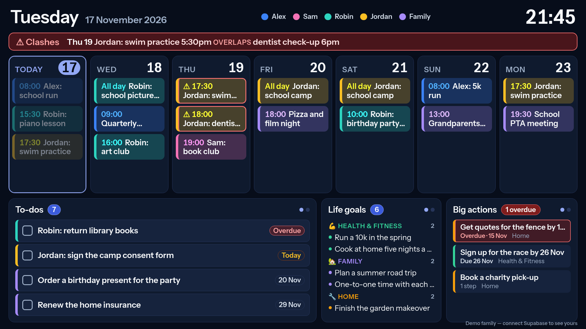

# Martin's Life Dashboard

> **Family board:** `/board` (phone + laptop) and `/tv` (the TV) show the
> family's week, to-dos, goals and big actions. Sign-in is a magic link
> with an email allowlist; TVs use revocable read-only links. To set it up,
> see [MIGRATION_NOTES.md](MIGRATION_NOTES.md). To push the box's to-dos
> and calendar in, see [docs/BOX_SYNC.md](docs/BOX_SYNC.md).
>
> 

Rebuild of the single-file `martin-dashboard.html` app as a hosted React app with
a real database, so the same data is on the phone, the work PC and the home PC.

- **Frontend**: React 18 + Vite, plain CSS (no component library)
- **Database**: Supabase (Postgres) with realtime sync
- **Hosting**: Vercel
- **Browser**: works in Edge, desktop and mobile

---

## Run it right now, with no setup

```bash
npm install && npm run dev
```

With no Supabase credentials the app runs in **local-only mode**: all data lives in
`localStorage`, seeded from the old dashboard's contents. The header shows
`○ local only`. Everything works — it just doesn't sync between devices.

Once Supabase is wired up the header shows `☁ synced` instead.

---

## Step 1 — Create the Supabase project

I can't do this part for you; it needs your account login.

1. Go to <https://supabase.com/dashboard> and sign in.
2. **New project**. Name it `life-dashboard`. Pick a region near Texas
   (`us-east-1` or `us-west-1`). Set a database password and save it in your
   password manager — you won't need it for this app, but you'll want it later.
3. Wait for the project to finish provisioning (a minute or two).

## Step 2 — Create the tables

1. In the project, open **SQL Editor** → **New query**.
2. Paste the entire contents of [`supabase/schema.sql`](supabase/schema.sql) and hit **Run**.
3. Then run each file in [`supabase/migrations/`](supabase/migrations) in name order,
   following [MIGRATION_NOTES.md](MIGRATION_NOTES.md) (allowlist, auth settings).
   Everything is safe to re-run.

## Step 3 — Point the app at Supabase

1. In Supabase go to **Project Settings → API**.
2. Copy the **Project URL** and the **anon / public** key.
3. In this folder, copy `.env.example` to `.env.local` and fill them in:

```
VITE_SUPABASE_URL=https://xxxxxxxxxxxx.supabase.co
VITE_SUPABASE_ANON_KEY=eyJhbGciOi...
```

4. Restart `npm run dev`. The header should now read `☁ synced`.

The first load with an empty database seeds the 8 domains, their folders, goals
and actions automatically — no seed SQL to run by hand.

## Step 4 — Deploy to Vercel

1. Commit and push this folder to a GitHub repo.
2. In Vercel: **Add New → Project**, import the repo.
3. Framework preset: **Vite**. Build command `npm run build`, output `dist`
   (Vercel detects both).
4. Under **Environment Variables**, add the same two `VITE_SUPABASE_URL` and
   `VITE_SUPABASE_ANON_KEY` values. Add them for Production, Preview and Development.
5. Deploy. Open the URL in Edge on your phone and on the work PC — same data.

Vite only exposes variables prefixed `VITE_`, and they are **baked into the
client bundle at build time**. Changing them in Vercel needs a redeploy.

---

## Access

With Supabase configured, the app asks for an email and sends a magic link
(Supabase Auth). Only accounts that already exist can sign in, and the
database only shows data to confirmed emails listed in `app_members`
(row-level security on every table). The publishable key in the bundle can
do nothing else. TVs get a read-only link instead (Family board → TV
screens). Details are in [MIGRATION_NOTES.md](MIGRATION_NOTES.md).

`VITE_APP_PASSPHRASE` still puts a passphrase screen in front of the
local-only (no Supabase) mode. It's a curtain, not security.

---

## Importing your old data

The app seeds itself from the old dashboard's contents, so it looks right
immediately. But if you have edits in the real thing that aren't in the seed:

1. Open the new app **in the same browser** where you used `martin-dashboard.html`.
2. A gold banner appears: *"Found your old dashboard in this browser — N goals…"*.
3. Click **Import**.

This **replaces** everything currently in the app with the old data — it does not
merge. Your old HTML file is never touched. The banner only appears if the
`mdc-v6` localStorage key is present in that browser, so do the import from
whichever machine you actually used the old dashboard on.

---

## The data model

Every domain owns a tree of folders. Folders nest without limit. Items live in
folders and carry a type; actions hang off goals.

```
Domain (health, career, …)
└── Folder                          parent_folder_id = null
      └── Folder                    any depth
            ├── Goal                → Action, Action, Action
            ├── Task
            ├── Consideration
            └── To Research
```

Notes on how this differs from a naive reading of the schema:

- **The Pending inbox is a chat row** with `domain_id`, `folder_id` and
  `person_id` all null. Dragging a card onto a domain just sets `domain_id`.
- **Person goals reuse the item model.** Each person has a hidden folder named
  `__person__<id>` in the family domain, created the first time you open their
  panel. It's filtered out of the domain tree, so you never see it as a folder.
- **`chats` keeps `title` / `url` / `meta`** rather than the single `text` column
  in the original spec sketch — the old app stored all three and they're all used
  in the UI.
- **A database constraint enforces the nesting rule**: `type = 'action'` requires
  a `parent_item_id`, and every other type forbids one.

## Layout

```
src/
  lib/
    seed.js       the 8 domains, folders, goals and actions, lifted from the old file
    backend.js    supabase | localStorage, behind one interface
    store.js      in-memory tree, selectors, optimistic mutations
    migrate.js    one-time import of the old 'mdc-v6' blob
    meals.js      weekly dinner plan, safe foods and grocery list — edit weekly
  components/
    Tree.jsx        recursive SVG tidy-tree — the primary navigation
    Dashboard.jsx   8 domain tiles + pending inbox
    DomainView.jsx  breadcrumb, tree, folder/item detail, chats
    ItemList.jsx    typed items, goals expand to show actions
    Lists.jsx       cross-domain sortable/filterable tables
    FamilyTree.jsx  the people tree
    PersonPanel.jsx per-person goals and chats
    MealPlanner.jsx Meals tab: renders meals.js; grocery ticks in localStorage
    board/          the family board: FamilyBoard (/board), TvBoard + TvPage (/tv),
                    ReviewPanel (weekly review remote), DeviceLinks (TV links)
  lib/tz.js         America/Chicago dates; all-day events stay dates
  lib/board.js      shared board logic (members, week, clashes, goals, actions)
  lib/boardData.js  member / TV-device / demo data sources
  lib/auth.js       magic-link sign-in + allowlist check
scripts/sync-box/   box SQLite → Supabase sync (docs/BOX_SYNC.md)
supabase/schema.sql
supabase/migrations/
```

## Offline behaviour

Reads and writes hit the in-memory copy first, so the UI never waits on the
network. Writes are then pushed to Supabase; a failed write reloads from the
server so the screen doesn't claim something was saved when it wasn't. A dropped
connection means edits made while offline are lost on the next refresh — this is
graceful degradation, not a full offline queue.
